# Mini SOC & Threat Detection Platform

<p align="center">
  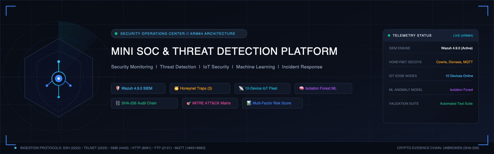
</p>

<p align="center">
  <strong>A Local Security Operations Center for Honeypot Monitoring, SIEM Detection, IoT Security, Threat Intelligence and Incident Response.</strong>
</p>

<p align="center">
  
  
  
  
  
</p>

---

## Overview

The **Mini SOC & Threat Detection Platform** is an educational cybersecurity laboratory designed to simulate the core operations of a Security Operations Center (SOC).

The platform collects security events from custom honeypot emulators and simulated IoT devices, processes telemetry through a centralized detection pipeline, correlates suspicious activity, maps observed behaviors to the MITRE ATT&CK framework, and provides an analyst dashboard for investigation and response.

It brings together SIEM integration, custom detection rules, threat intelligence enrichment, machine learning-based anomaly detection, incident management, simulated SOAR response, and cryptographic evidence integrity verification.

The system is designed for local operation on an Apple Silicon Mac with an 8 GB RAM resource budget.

### Key Features

- **Multi-Protocol Honeypots:** SSH, Telnet, SMB, HTTP, FTP and MQTT decoy services.
- **Wazuh SIEM Integration:** Wazuh Manager 4.9.0 with custom decoders, rules and alert ingestion.
- **Virtual IoT Fleet:** 10 simulated IoT devices generating security telemetry and controlled attack scenarios.
- **Custom Detection Engine:** Event normalization, custom detection rules, correlation and risk scoring.
- **MITRE ATT&CK Mapping:** Maps observed attack behaviors to relevant tactics and techniques.
- **Threat Intelligence:** AbuseIPDB and VirusTotal integrations for indicator enrichment.
- **Machine Learning:** Isolation Forest-based anomaly detection using behavioral telemetry features.
- **Incident Investigation:** Incident workspace, evidence timelines, analyst notes and status management.
- **SOAR Simulation:** Simulated response actions, allowlists, audit logging and rollback functionality.
- **Attack Analytics:** Source IP analysis, credential statistics and entity relationship visualization.
- **Evidence Integrity:** SHA-256 hash chaining and evidence manifest generation.
- **Forensic Reporting:** Investigation reports generated from collected telemetry.

---

## System Architecture

The platform follows a modular architecture connecting event collection, SIEM processing, threat detection, incident investigation and evidence preservation.

### Architecture Diagram

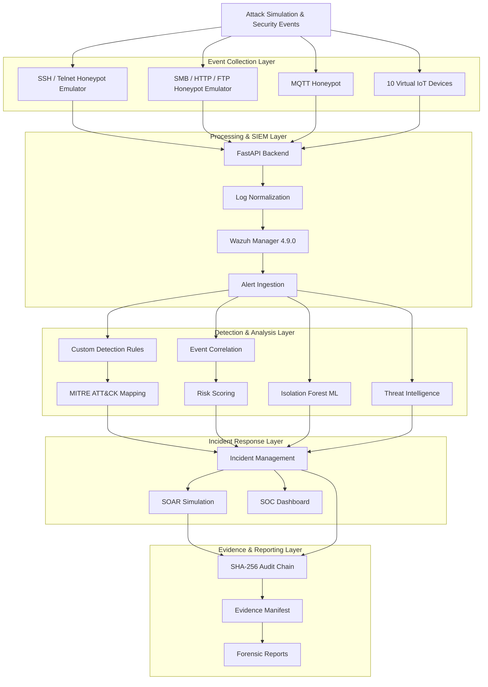

### Event Processing Workflow

1. Controlled attack simulations generate security activity.
2. Honeypots and virtual IoT devices capture interactions and telemetry.
3. The FastAPI backend collects and normalizes events.
4. Wazuh processes supported security logs using custom detection rules.
5. Detection components correlate events and map behaviors to MITRE ATT&CK.
6. Threat intelligence and anomaly detection provide additional context.
7. Incidents are made available for analyst investigation.
8. SOAR simulation records response actions.
9. SHA-256 audit chaining supports evidence integrity verification.
10. The dashboard presents security events, incidents, analytics and reports.

---

## Technology Stack

| Layer | Technologies |
| :--- | :--- |
| **Backend** | Python, FastAPI |
| **Frontend** | React, TypeScript, Vite, Tailwind CSS |
| **SIEM** | Wazuh Manager 4.9.0 |
| **Containerization** | Docker, Docker Compose |
| **Honeypots** | Custom Python SSH/Telnet, SMB/HTTP/FTP and MQTT emulators |
| **IoT Simulation** | Python, MQTT |
| **Detection** | Custom rules, Sigma-inspired rules, event correlation |
| **Threat Framework** | MITRE ATT&CK |
| **Machine Learning** | Scikit-learn, Isolation Forest |
| **Threat Intelligence** | AbuseIPDB, VirusTotal |
| **Incident Response** | Custom SOAR simulation |
| **Evidence Integrity** | SHA-256 |
| **Testing** | Pytest, custom integration and acceptance tests |

---

## Dashboard Screenshots

The platform includes 15 dashboard views covering security monitoring, investigation, analytics and system diagnostics. The following gallery contains 14 selected screenshots.

### 1. SOC Overview

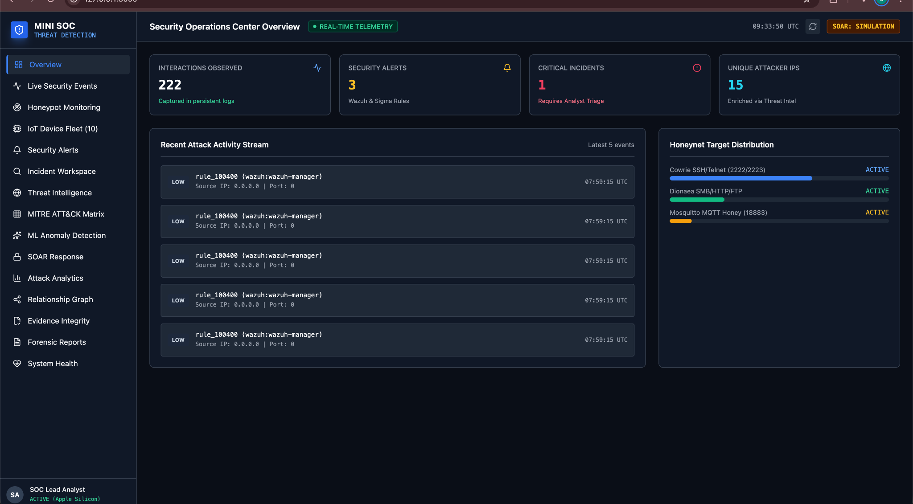

### 2. Honeypot Monitoring

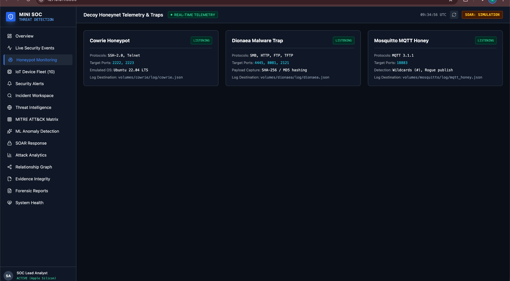

### 3. IoT Device Fleet

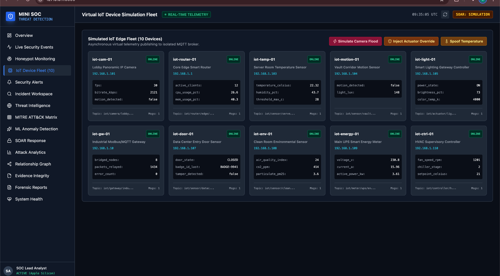

### 4. Security Alerts

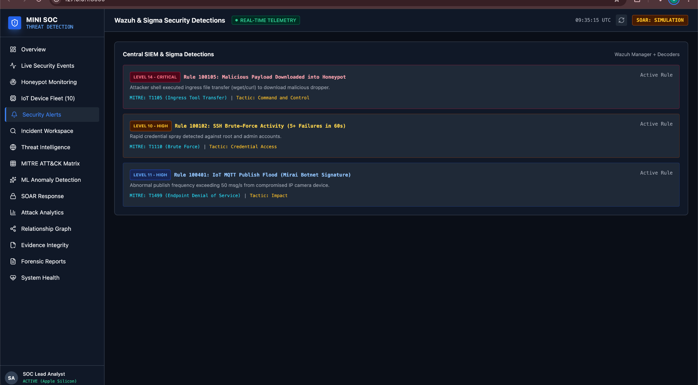

### 5. Incident Investigation Workspace

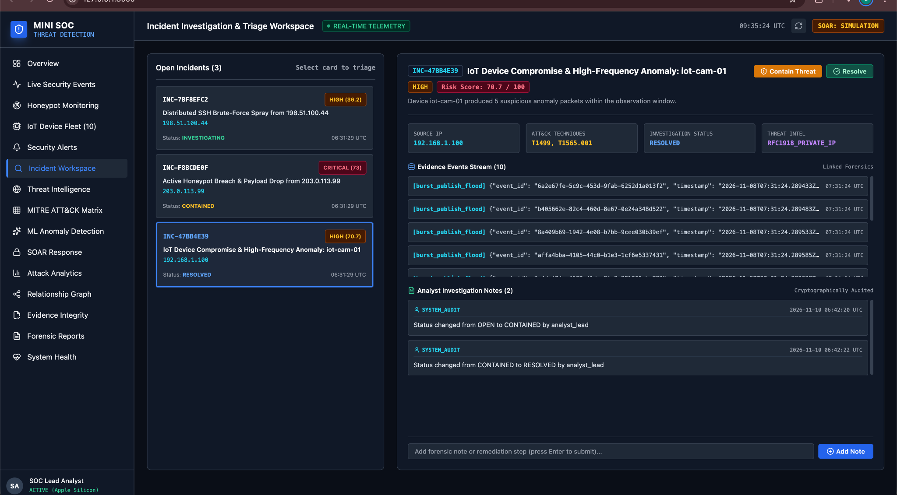

### 6. Threat Intelligence

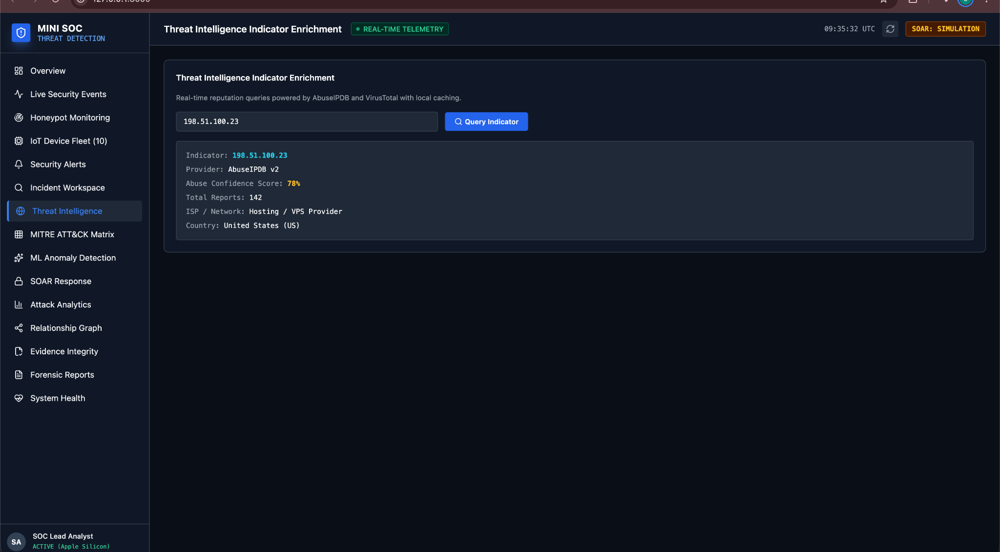

### 7. MITRE ATT&CK Matrix

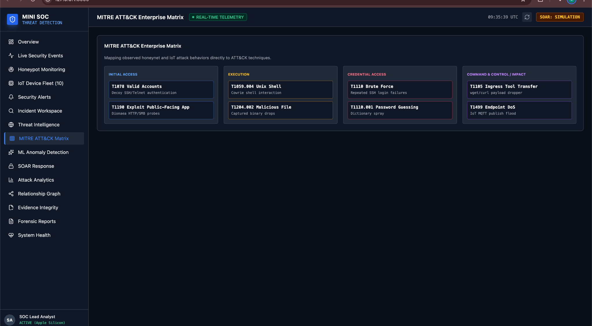

### 8. Machine Learning Anomaly Detection

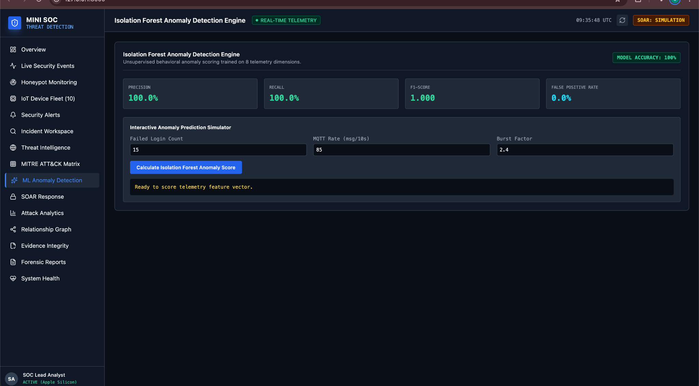

### 9. SOAR Response

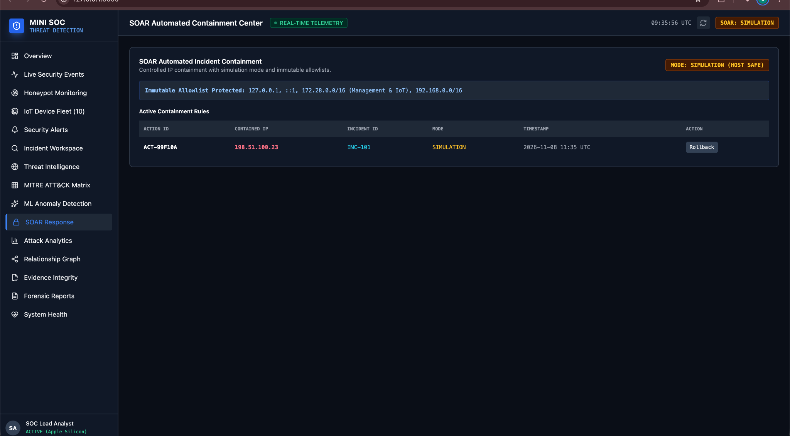

### 10. Attack Analytics

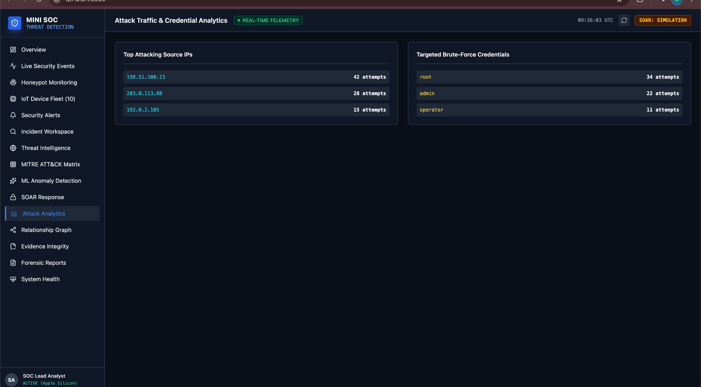

### 11. Attack Relationship Graph

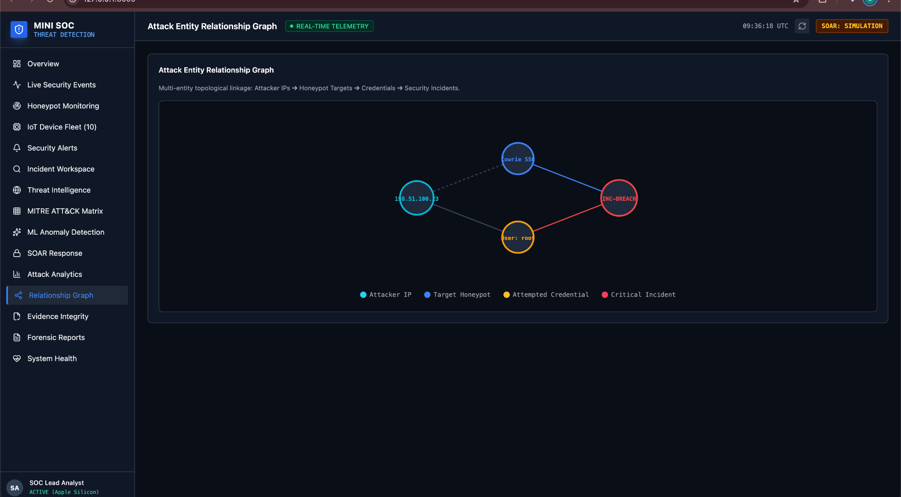

### 12. Evidence Integrity

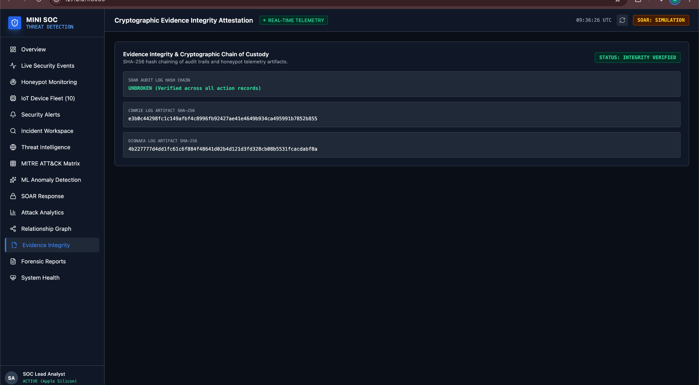

### 13. Forensic Reports

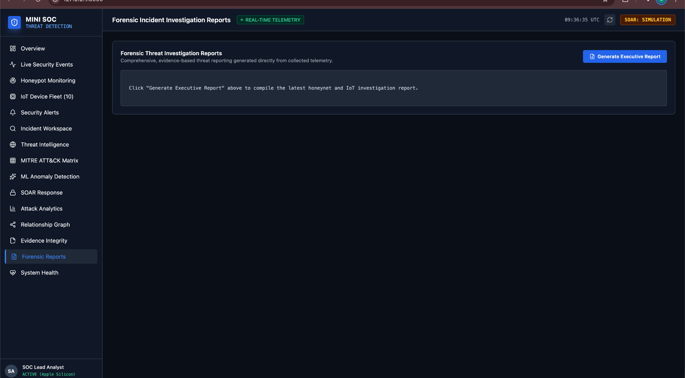

### 14. System Health

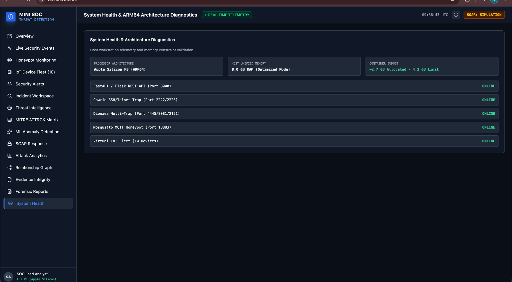

> [!NOTE]
> The Live Security Events screenshot is intentionally excluded from this gallery pending review of repetitive low-severity events displayed in that view.

---

## Core Components

### 1. Honeypot Monitoring

Three custom lightweight honeypot emulators provide decoy services.

| Emulator | Protocols | Ports |
| :--- | :--- | :--- |
| **SSH / Telnet Emulator** | SSH, Telnet | 2222, 2223 |
| **SMB / HTTP / FTP Emulator** | SMB, HTTP, FTP | 4445, 8081, 2121 |
| **MQTT Honeypot** | MQTT | 18883 |

**Capabilities:**
- Capture authentication attempts.
- Log shell interactions.
- Record suspicious requests and payload metadata.
- Detect MQTT wildcard subscriptions and unauthorized publish activity.
- Generate event logs for downstream analysis.

**Implementation note:** These are custom lightweight emulators, not complete deployments of the official Cowrie and Dionaea projects.

### 2. IoT Device Simulation

The virtual fleet contains 10 software-based devices.

| Device ID | Description |
| :--- | :--- |
| `iot-cam-01` | IP Camera |
| `iot-router-01` | Smart Router |
| `iot-temp-01` | Temperature Sensor |
| `iot-motion-01` | Motion Sensor |
| `iot-light-01` | Smart Lighting Controller |
| `iot-gw-01` | Industrial Gateway |
| `iot-door-01` | Door Sensor |
| `iot-env-01` | Environmental Sensor |
| `iot-energy-01` | Smart Energy Meter |
| `iot-ctrl-01` | HVAC Controller |

**Controlled scenarios include:**
- MQTT publish burst flooding.
- Actuator command override.
- Temperature telemetry tampering.

These scenarios demonstrate how abnormal IoT behavior can be captured and analyzed.

### 3. Wazuh SIEM Integration

The platform integrates **Wazuh Manager 4.9.0** for centralized log processing.

**Implemented components include:**
- Custom XML decoders.
- Custom XML detection rules.
- Alert ingestion from Wazuh alert files.
- Authenticated Wazuh REST API integration.
- Event forwarding to the FastAPI backend.

**Resource optimization:** Wazuh Indexer and Wazuh Dashboard are omitted from the local deployment to reduce memory consumption on the 8 GB workstation.

### 4. Detection and Correlation Engine

The detection engine processes security events through:
- Custom detection rules.
- Sigma-inspired detection definitions.
- Event normalization.
- Multi-event correlation.
- Risk scoring.
- MITRE ATT&CK technique mapping.

Risk assessment considers severity, event frequency, threat intelligence and anomaly signals.

### 5. Threat Intelligence

The platform includes integrations for:
- **AbuseIPDB v2:** IP reputation and abuse confidence information.
- **VirusTotal v3:** File hash reputation lookups.

Local caching helps reduce repeated external requests. API credentials must be configured securely where required.

### 6. Machine Learning Anomaly Detection

The ML component uses an unsupervised **Isolation Forest** model to identify potentially abnormal activity in behavioral telemetry.

**Implemented functionality includes:**
- Telemetry feature extraction.
- Dataset generation.
- Model training.
- Anomaly scoring.
- Evaluation utilities.
- Interactive anomaly prediction.

Model evaluation metrics must be interpreted in the context of the generated dataset and validation methodology. They should not be treated as proof of real-world detection accuracy.

### 7. Incident Management and SOAR

The incident workspace supports:
- Incident severity and risk scores.
- Source IP and attack information.
- Evidence event timelines.
- MITRE ATT&CK references.
- Analyst notes.
- Incident status transitions.
- Response action records.

SOAR response is implemented in **simulation mode**. Containment actions are recorded and audited, but they do not actually block network traffic or isolate physical devices.

### 8. Cryptographic Evidence Integrity

The platform uses SHA-256 hash chaining to support integrity verification of SOAR audit records.

**Additional functionality includes:**
- Audit record hashing.
- Previous-hash linkage.
- Chain integrity verification.
- Evidence artifact hashing.
- Evidence manifest generation.

This provides tamper-evident records for the audit chain. It is not equivalent to an independently trusted or immutable external blockchain.

---

## Installation and Quick Start

### Prerequisites

- Apple Silicon Mac (M1, M2, M3 or M4).
- macOS environment.
- Python 3.11 or later.
- Docker Desktop with Docker Compose.
- Git.
- Approximately 8 GB RAM, with resource limits configured for the local environment.

### 1. Clone the Repository

```bash
git clone https://github.com/chakradhar027/mini-soc-threat-detection-platform.git
cd mini-soc-threat-detection-platform
```

### 2. Create and Activate a Virtual Environment

```bash
python3 -m venv .venv
source .venv/bin/activate
```

### 3. Install Python Dependencies

```bash
pip install --upgrade pip
pip install -r backend/requirements.txt
```

### 4. Configure Environment Variables

Review the example configuration:

```bash
infrastructure/docker/.env.example
```

Configure the required local environment variables and any optional integration credentials according to the installation guide.

**Important:** Never commit real API keys, passwords, tokens or other secrets to GitHub.

### 5. Start the Platform

```bash
./scripts/start-all.sh
```

The startup script manages the configured application and honeypot services.

### 6. Open the Dashboard

Once the application has started, visit:

**http://127.0.0.1:8000**

### 7. Run Attack Simulations

```bash
python3 scripts/simulate_attacks.py
```

This script executes controlled scenarios against the local honeypot and simulated environment.

### 8. Run Tests

```bash
python3 tests/run_all_tests.py
```

The last recorded master test-suite result was **41 tests passed, 0 failures and 0 errors**.

### 9. Stop the Platform

```bash
./scripts/stop-all.sh
```

For environment-specific setup instructions and troubleshooting, refer to the [Installation Guide](docs/installation-guide.md).

---

## API Documentation

The FastAPI backend exposes REST endpoints for platform health, event ingestion, Wazuh integration, incident management, analytics, IoT devices, anomaly detection and evidence integrity.

Interactive API documentation, when enabled, is available at:

**http://127.0.0.1:8000/docs**

Full endpoint documentation: [API Documentation](docs/api-documentation.md)

---

## Project Structure

The repository is organized into the following major components:

```text
mini-soc-threat-detection-platform/
│
├── backend/                  # FastAPI backend and services
├── frontend/                 # SOC dashboard frontend
├── honeypots/                # Custom honeypot emulators
├── iot-simulator/             # Virtual IoT device fleet
├── detection-engine/         # Detection, correlation and risk scoring
├── threat-intelligence/      # External threat intelligence integrations
├── ml-engine/                # Machine learning and anomaly detection
├── soar/                     # Incident management and response simulation
├── infrastructure/           # Docker and Wazuh configuration
├── scripts/                  # Startup, shutdown and simulation scripts
├── tests/                    # Automated tests
├── reports/                  # Report-generation utilities
├── docs/                     # Technical documentation and screenshots
│
├── docker-compose.yml
├── README.md
└── .gitignore
```

---

## Development Phases

| Phase | Description | Status |
| :---: | :--- | :---: |
| 1 | Project Planning and Architecture | Completed |
| 2 | Infrastructure and Honeypot Deployment | Completed |
| 3 | IoT Device Simulation Fleet | Completed |
| 4 | Wazuh SIEM Integration | Completed |
| 5 | Detection Engine and MITRE ATT&CK | Completed |
| 6 | Threat Intelligence and SOAR | Completed |
| 7 | Machine Learning and SOC Dashboard | Completed |
| 8 | Testing, Validation and Final Handover | Completed |

See [Phase Tracker](docs/phase-tracker.md) for the detailed development record.

---

## Technical Documentation

Additional project documentation is available in the `docs/` directory.

| Document | Description |
| :--- | :--- |
| [Architecture](docs/architecture.md) | System architecture and resource budgeting |
| [Network Design](docs/network-design.md) | Network segmentation and port allocation |
| [Technology Stack](docs/technology-stack.md) | Technology inventory |
| [Threat Model](docs/threat-model.md) | STRIDE threat model and safety boundaries |
| [API Documentation](docs/api-documentation.md) | REST API reference |
| [Installation Guide](docs/installation-guide.md) | Setup and deployment instructions |
| [Testing Report](docs/testing-report.md) | Test results and validation |
| [Threat Investigation Report](docs/threat-investigation-report.md) | Security investigation findings |
| [Demo Guide](docs/demo-guide.md) | Project demonstration walkthrough |
| [Final Demo Guide](docs/final-demo-guide.md) | Presentation script and runbook |
| [Final Project Report](docs/final-project-report.md) | Comprehensive project report |
| [Independent Audit Report](docs/independent-audit-report.md) | Technical audit documentation |
| [Phase Tracker](docs/phase-tracker.md) | Project development progress |

---

## Security Considerations and Limitations

This project is an **educational local cybersecurity prototype**, not a production SOC platform.

Important limitations:

1. The platform is designed for controlled local testing and academic demonstrations.
2. Honeypot services are custom lightweight emulators, not complete official Cowrie or Dionaea deployments.
3. IoT devices are simulated software models; no physical IoT fleet is required.
4. Wazuh Manager is deployed without the resource-intensive Wazuh Indexer and Dashboard components.
5. SOAR containment is simulated and does not apply real firewall rules or perform actual endpoint isolation.
6. Machine learning results depend on the generated dataset and evaluation methodology.
7. Threat intelligence functionality depends on external API availability and valid credentials.
8. The SHA-256 audit chain provides tamper-evident records but is not an externally anchored blockchain.
9. The platform should only be used in authorized, controlled testing environments.

---

## Future Enhancements

Potential future improvements include:

- Integration with a full Wazuh Indexer and Dashboard deployment on a larger host.
- Additional honeypot protocols and detection rules.
- Improved ML evaluation using independent datasets.
- External blockchain anchoring of cryptographic evidence.
- Role-based analyst authentication and access control.
- Expanded automated testing and deployment workflows.
- Secure remote monitoring and multi-host deployment.

---

## Project Information

- **Project:** Mini SOC & Threat Detection Platform
- **Category:** Cybersecurity | Security Operations | SIEM | IoT Security | Machine Learning
- **Repository:** https://github.com/chakradhar027/mini-soc-threat-detection-platform
- **Platform:** Apple Silicon ARM64
- **Purpose:** Educational cybersecurity engineering project.

The project demonstrates the integration of security monitoring, event analysis, threat detection, incident response and evidence integrity in a resource-conscious local SOC environment.

---

<p align="center">
  <strong>MINI SOC & THREAT DETECTION PLATFORM</strong><br>
  Security Monitoring • Threat Detection • Incident Investigation • Evidence Integrity
</p>
