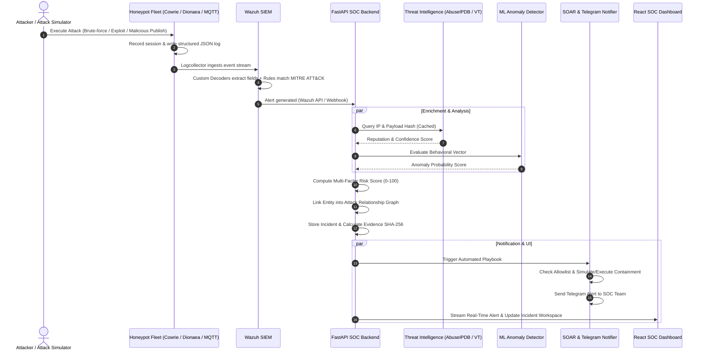

# Architecture Specification: Mini SOC & Threat Detection Platform

## 1. System Overview

The **Mini SOC and Threat Detection Platform** is an enterprise-grade, modular, locally deployable Security Operations Center architecture designed to run on Apple Silicon (ARM64) macOS workstations. It emulates a realistic hybrid infrastructure monitoring enterprise services, honeypots, and simulated IoT deployments.

The platform provides end-to-end security operations capability:
```
[ATTACK SIMULATION] 
        │
        ▼
[HONEYPOT COLLECTION & IoT FLEET]
        │ (JSON & Syslog Event Streams)
        ▼
[LOG INGESTION & PARSING] (Wazuh Agent / Logcollector)
        │
        ▼
[SIEM DETECTION & NORMALIZATION] (Wazuh Manager + Decoders/Rules + Sigma)
        │ (Security Alerts + MITRE ATT&CK Mapping)
        ▼
[THREAT INTELLIGENCE ENRICHMENT] (AbuseIPDB & VirusTotal Caching Engine)
        │
        ▼
[INTELLIGENT RISK SCORING] (Multi-factor explainable algorithm)
        │
        ▼
[INCIDENT INVESTIGATION WORKSPACE] ◄──► [ATTACK RELATIONSHIP GRAPH]
        │
        ▼
[SOAR AUTOMATED RESPONSE] (Telegram Alerts + Controlled IP Containment)
        │
        ▼
[SOC ANALYST DASHBOARD & FORENSIC REPORTS] (React 18 + FastAPI + SQLite/Postgres + ML Engine)
```

---

## 2. Core Architectural Components

### 2.1 Attack Simulation & Honeynet Layer
- **Cowrie Honeypot**: An emulated medium-to-high interaction SSH and Telnet honeypot designed to log brute-force attempts and shell interaction, capturing attacker session metadata, username/password dictionaries, downloaded payloads, and terminal commands in structured JSON format (`cowrie.json`).
- **Dionaea Honeypot**: A low-to-medium interaction malware capture honeypot emulating vulnerable protocols (SMB, HTTP, FTP, TFTP). Captures shellcode, network interaction streams, and automated payload drop attempts.
- **Mosquitto MQTT Honeypot**: A monitored MQTT broker instance exposed on an alternate honeynet port configured to capture unauthorized broker probing, malicious publish attempts, wildcard topic subscriptions (`#`), and credential guessing against IoT control channels.

### 2.2 IoT Device Simulation Fleet
A software-driven, asynchronous IoT simulator built with Python and Paho MQTT:
- Emulates 10 distinct IoT device types:
  1. IP Camera
  2. Smart Router
  3. Temperature Sensor
  4. Motion Sensor
  5. Smart Lighting Controller
  6. MQTT Gateway
  7. Door Sensor
  8. Environmental Sensor
  9. Smart Energy Meter
  10. Device Monitoring Controller
- Generates baseline telemetry (heartbeats, periodic sensor metrics, state transitions) alongside controlled malicious traffic (sensor tampering, burst flooding, unauthorized control topics, credential spray).

### 2.3 Log Collection and Normalization Pipeline
- Centralized log mount architecture: Honeypot and IoT event streams write directly to isolated, read-only Docker volume paths on the host.
- **Wazuh Logcollector**: Ingests `cowrie.json`, Dionaea JSON/SQLite event summaries, Mosquitto event logs, and IoT simulator telemetry.
- **Custom Wazuh Decoders**: Extract structured fields (`srcip`, `srcport`, `dstuser`, `command`, `protocol`, `mqtt_topic`, `payload_hash`).
- **Normalized Schema**: Normalizes events according to Elastic Common Schema (ECS) and Wazuh alert schema.

### 2.4 Wazuh SIEM Core
- **Wazuh Manager**: Central brain performing real-time ruleset analysis, alerting, compliance checks, and external API exposure.
- **Wazuh Indexer**: Scalable OpenSearch-based indexer storing raw events and alerts.
  - *Memory Optimization for 8GB Mac*: Indexer JVM heap is restricted to `512m` minimum / `1024m` maximum to prevent host OOM conditions.
- **Wazuh Dashboard**: Web-based analytical visualization UI for Wazuh alerts.

### 2.5 Custom Detection Engine & MITRE ATT&CK
- **Sigma Detection Library**: Vendor-neutral detection rules translated into native Wazuh rules targeting honeypot & IoT attack patterns.
- **MITRE ATT&CK Matrix**: Dynamic mapping of events to ATT&CK tactics & techniques (e.g., `T1110 - Brute Force`, `T1059 - Command & Scripting Interpreter`, `T1046 - Network Service Discovery`, `T1078 - Valid Accounts`).
- **Correlation Engine**: Multi-event correlation (e.g., Brute Force Success followed by payload download within 60 seconds triggers a Critical incident).

### 2.6 Threat Intelligence Enrichment
- **AbuseIPDB Integration**: Real-time validation of public attacker IP addresses, extracting abuse confidence scores, report counts, and ISP metadata.
- **VirusTotal Integration**: Hash-lookup service for captured files and downloaded payloads (`SHA-256`, `MD5`) without uploading live samples.
- **Local Persistence & Caching**: SQLite/PostgreSQL caching layer with 24-hour TTL to prevent external API quota exhaustion and handle offline operation.

### 2.7 Intelligent Risk Scoring
An explainable, multi-factor scoring model that outputs a composite score from `0 to 100`:
$$\text{Risk Score} = \min\left(100, (\text{Severity}_{\text{base}} \times 0.35) + (\text{Freq}_{\text{norm}} \times 0.20) + (\text{TI}_{\text{norm}} \times 0.25) + (\text{ML}_{\text{anomaly}} \times 0.20)\right)$$
Every score displays its exact weight breakdown, preventing "black-box" risk assessments.

### 2.8 Machine Learning Anomaly Detection
- **Isolation Forest Model**: Unsupervised anomaly detection trained on normal IoT and network telemetry.
- **Feature Vector**:
  - Message frequency per minute
  - Authentication failure ratio
  - Unique destination ports accessed
  - Off-hours temporal variance
  - Topic entropy
- Exposes a REST inference endpoint consumed by the backend pipeline to flag stealthy behavioral deviations that bypass static rules.

### 2.9 SOAR Automation Engine
- **Alert Ingestion**: Subscribes to Wazuh alerts via REST polling or webhook.
- **Telegram Notification Bot**: Real-time mobile alerts with interactive buttons for SOC analysts.
- **Response Engine**:
  - Simulated firewall containment mode (default, completely safe).
  - Controlled containment mode for dedicated test subnets.
  - Strict host allowlist protecting `127.0.0.1`, LAN gateway, and management IPs.
  - One-click rollback and cryptographic audit trail.

### 2.10 SOC Analyst Dashboard & Investigation Workspace
- **FastAPI Backend**: High-performance asynchronous REST API handling authentication, incident lifecycle, graph queries, and alert streaming.
- **React 18 + Vite + Tailwind Frontend**:
  - Live Security Events feed
  - Interactive Attack Relationship Graph (Force-directed network visualization connecting IPs, honeypots, credentials, alerts, and incidents)
  - Incident Investigation Workspace with audit log and timeline reconstruction
  - Evidence integrity verification showing SHA-256 validation status of logs
  - Threat Intelligence lookup console

---

## 3. End-to-End Event Flow



---

## 4. Hardware & Resource Budgeting (8 GB RAM Apple Silicon)

Given the development machine has **8 GB unified memory**, the resource allocation across all containers is strictly budgeted to avoid swap thrashing and maintain responsiveness:

| Component | Container / Service | Memory Reservation | Memory Limit | CPU Limit |
|---|---|---|---|---|
| **Wazuh Indexer** | `wazuh-indexer` (OpenSearch) | 768 MB (Heap: 512M) | 1200 MB | 1.5 cores |
| **Wazuh Manager** | `wazuh-manager` | 512 MB | 800 MB | 1.0 cores |
| **Wazuh Dashboard** | `wazuh-dashboard` | 256 MB | 512 MB | 0.5 cores |
| **Cowrie Honeypot** | `cowrie` | 128 MB | 256 MB | 0.25 cores |
| **Dionaea Honeypot** | `dionaea` | 128 MB | 256 MB | 0.25 cores |
| **Mosquitto Honeypot & IoT Broker**| `mosquitto` | 64 MB | 128 MB | 0.25 cores |
| **PostgreSQL Database** | `postgres` | 128 MB | 256 MB | 0.5 cores |
| **FastAPI Backend + ML Engine** | `soc-backend` | 256 MB | 512 MB | 1.0 cores |
| **React Frontend (Nginx/Dev)** | `soc-frontend` | 64 MB | 128 MB | 0.25 cores |
| **Grafana Monitoring** | `grafana` | 128 MB | 256 MB | 0.5 cores |
| **Total Allocation** | **All Services** | **~2.7 GB** | **~4.3 GB** | **< 6.0 cores** |

*Host buffer remaining*: ~3.7 GB RAM reserved for macOS, Docker Desktop VM overhead, and IDE processes.

