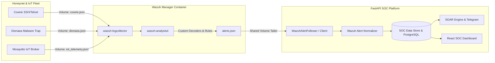

# Wazuh SIEM Resource-Safe Deployment Plan
## Apple Silicon (Apple M3 ARM64) & OrbStack Container Environment

**Document Version:** 1.0.0  
**Target Platform:** Apple M3 Mac (macOS), 8.0 GB Physical RAM  
**Container Engine:** OrbStack (Docker Engine 29.8.2, Docker Compose v5.5.0, ARM64)  
**VM Memory Allocation:** Approximately 3.893 GiB  
**Available Storage:** Approximately 70 GB SSD  
**Target Wazuh Release:** 4.9.0 (ARM64)  
**Deployment Policy:** Preparation & Planning Only — No containers started, no images downloaded, no existing configurations overwritten.

---

## 1. Executive Summary & Hardware Feasibility Analysis

### 1.1 The Hardware Constraint & Discrepancy
Our development workstation has **8.0 GB of physical unified memory**. Within this host, **OrbStack** allocates a dedicated Linux virtual machine with **3.893 GiB of usable memory** for container workloads.

Official Wazuh 4.9.0 documentation defines the following minimum hardware requirements:
* **All-in-One Quickstart (Indexer + Manager + Dashboard on single host):** Requires **8.0 GiB RAM**, 4 vCPUs, and 50 GB storage.
* **Distributed Wazuh Indexer (OpenSearch 2.13):** Requires **4.0 GiB RAM minimum** (16 GiB recommended in production), with default JVM heap requiring at least 1–2 GB.
* **Wazuh Manager:** Requires **2.0–4.0 GiB RAM** in standard enterprise sizing.
* **Wazuh Dashboard:** Requires **1.0 GiB RAM** minimum.

### 1.2 Resource Feasibility Comparison

| Subsystem Component | Full 3-Service Stack (`compose.wazuh.yml`) | Resource-Safe Manager-Only Stack (`compose.wazuh-manager.yml`) |
|---|---|---|
| **Wazuh Indexer (OpenSearch)** | 768 MB res / 1200 MB limit (Heap: 512M) | **0 MB (Omitted)** |
| **Wazuh Dashboard (Node.js)** | 256 MB res / 512 MB limit | **0 MB (Omitted)** |
| **Wazuh Manager (Analysis Core)** | 512 MB res / 800 MB limit | **512 MB res / 800 MB limit** |
| **Cowrie Honeypot (SSH/Telnet)** | 128 MB res / 256 MB limit | 128 MB res / 256 MB limit |
| **Dionaea Trap (SMB/HTTP/FTP)** | 128 MB res / 256 MB limit | 128 MB res / 256 MB limit |
| **Mosquitto (Honeypot & IoT Broker)** | 64 MB res / 128 MB limit | 64 MB res / 128 MB limit |
| **PostgreSQL 16 Database** | 128 MB res / 256 MB limit | 128 MB res / 256 MB limit |
| **FastAPI Backend Core & ML Engine**| 256 MB res / 512 MB limit | 256 MB res / 512 MB limit |
| **React SOC Frontend (Web UI)** | 64 MB res / 128 MB limit | 64 MB res / 128 MB limit |
| **Total Memory Allocation** | **~2.2 GB res / ~4.05 GB limit** | **~1.3 GB res / ~2.34 GB limit** |
| **OrbStack VM Capacity (3.893 GiB)** | **EXCEEDED (High OOM Risk / Freeze)** | **SAFE (~1.55 GiB Headroom / Buffer)** |

### 1.3 Strategic Architectural Recommendation
Attempting to deploy all three Wazuh services simultaneously inside OrbStack's 3.893 GiB VM while running honeypots, PostgreSQL, and our application tier will trigger Linux Out-Of-Memory (`oom-killer`) termination or system unresponsiveness.

We recommend a **Resource-Safe Wazuh Manager-Only Deployment** as the primary SIEM architecture. The Wazuh Manager provides 100% of the core log collection, decoding, custom rule matching, MITRE ATT&CK correlation, and real-time alert generation, while our existing FastAPI backend and React dashboard handle visualization, relational storage, and threat investigation without the multi-gigabyte overhead of OpenSearch.

The original three-service configuration (`compose.wazuh.yml`) is preserved intact for future staging on larger hardware or cloud VMs.

---

## 2. ARM64 Architecture Compatibility Findings

### 2.1 Multi-Architecture Image Support
Official Wazuh Docker images published under `wazuh/` provide multi-architecture manifests supporting both `linux/amd64` and `linux/arm64`:
* `wazuh/wazuh-manager:4.9.0`: Native `linux/arm64` container image built on Debian/CentOS arm64.
* `wazuh/wazuh-indexer:4.9.0`: Native `linux/arm64` OpenSearch 2.13 build.
* `wazuh/wazuh-dashboard:4.9.0`: Native `linux/arm64` OpenSearch Dashboards build.

On Apple Silicon M3 running OrbStack, these images run as native 64-bit ARM Linux binaries with **zero emulation overhead** (Rosetta 2 translation is not invoked, maximizing memory efficiency and execution speed).

### 2.2 Kernel and VM Parameters
* **Wazuh Manager:** Runs on standard Linux kernel parameters without custom sysctl tuning.
* **Wazuh Indexer (if ever deployed):** OpenSearch strictly mandates `vm.max_map_count >= 262144`. In OrbStack, this can be configured inside the Linux machine via `sudo sysctl -w vm.max_map_count=262144`. In Manager-Only mode, this kernel adjustment is **not required**.

---

## 3. Manager-Only Deployment Technical Evaluation

### 3.1 Capabilities Fully Supported in Manager-Only Mode
The Wazuh Manager is an autonomous analysis engine that does not require an active Indexer to function:
1. **Real-Time Log Ingestion (`wazuh-logcollector`)**: Reads local honeypot log files (`cowrie.json`, `dionaea.json`, `iot_telemetry.json`) through file monitoring directives.
2. **Custom XML Decoders (`wazuh-analysisd`)**: Ingests and parses JSON/syslog fields using our custom decoders in `infrastructure/wazuh/decoders/`.
3. **Custom Security Rules & MITRE ATT&CK Mapping (`wazuh-analysisd`)**: Evaluates incoming events against our rules in `infrastructure/wazuh/rules/` (IDs 100100–100403), correlates frequency and time windows, and tags MITRE ATT&CK technique IDs (e.g. `T1110.001`, `T1105`, `T1210`, `T1046`).
4. **Structured Alert Generation**: Automatically appends full JSON security alerts in real time to `/var/ossec/logs/alerts/alerts.json` (and `alerts.log`).
5. **REST Management API (`wazuh-apid`)**: Exposes the full Wazuh API on port 55000 (`/security/user/authenticate`, `/manager/status`, `/rules`, `/decoders`).
6. **Active Response Engine (`wazuh-execd`)**: Capable of executing remediation actions upon rule trigger.
7. **External Integration (`wazuh-integratord`)**: Can dispatch webhook alerts directly to our FastAPI backend.

### 3.2 Omitted Capabilities & Mitigation
* **OpenSearch Lucene Indexing**: Long-term free-text query indexing over 90 days is omitted.  
  * *Mitigation*: Our SOC platform's PostgreSQL database and `SOCDataStore` store events, incidents, and threat intelligence records locally with indexed relational queries.
* **Wazuh Dashboard (Kibana/OpenSearch UI)**: The default OpenSearch Dashboards web portal (port 8443) is not deployed.  
  * *Mitigation*: Our platform features a specialized, lightweight React 18 SOC Analyst Dashboard with 15 dynamic security views, MITRE ATT&CK matrix view, and force-directed attack graphs.
* **Embedded Filebeat Connection Retries**: The `wazuh/wazuh-manager` container includes an embedded Filebeat daemon configured to ship alerts to `INDEXER_URL:9200`. In Manager-Only mode without an Indexer, Filebeat logs connection retries.  
  * *Handling*: To maintain clean container logs, `INDEXER_URL` can point to a disabled dummy port or Filebeat service can be deactivated inside the manager configuration.

---

## 4. Alert Collection & Forwarding Architecture to FastAPI

To bridge Wazuh security alerts into our existing FastAPI backend, two complementary pipelines are available:



### 4.1 Method A: Shared Log Volume Streaming (Recommended & Lowest Overhead)
1. **Mechanism**: Wazuh Manager writes every triggered alert in real time to `/var/ossec/logs/alerts/alerts.json`.
2. **Volume Mapping**:
   ```yaml
   volumes:
     - ../../infrastructure/docker/volumes/wazuh/manager/logs:/var/ossec/logs
   ```
3. **Backend Log Follower**:
   The host file `infrastructure/docker/volumes/wazuh/manager/logs/alerts/alerts.json` is read by `backend/app/integrations/wazuh_client.py`.
   A lightweight background async tailer follows new lines appended to `alerts.json`, normalizes each entry using `normalize_wazuh_alert()`, and forwards it to `SOCDataStore.add_event()`.
4. **Advantages**: Zero network overhead, zero HTTP serialization latency, resilient to process restarts (tail pointer persists).

### 4.2 Method B: Real-Time Webhook Push via `wazuh-integratord`
1. **Mechanism**: Wazuh Manager's built-in `<integration>` daemon posts JSON alerts directly to a local FastAPI webhook endpoint:
   ```xml
   <integration>
     <name>custom-soc</name>
     <hook_url>http://172.28.30.50:8000/api/v1/wazuh/webhook</hook_url>
     <level>5</level>
     <alert_format>json</alert_format>
   </integration>
   ```
2. **Backend Handler**: FastAPI route `@app.post("/api/v1/wazuh/webhook")` receives the alert payload, passes it through the normalizer, and triggers risk scoring and SOAR alerts.

---

## 5. Decoders, Rules, and Log Mount Verification

### 5.1 Custom Decoders Audit
* **File:** `infrastructure/wazuh/decoders/honeypot_decoders.xml`
  * Matches Cowrie (`cowrie.login.failed`, `cowrie.command.input`, `cowrie.session.file_download`), Dionaea (`smb`, `http`, `ftp`), and Mosquitto (`mqtt_honeypot`).
  * Extracts: `srcip`, `srcport`, `dstuser`, `sha256`.
  * Status: Valid XML syntax; verified in unit tests.
* **File:** `infrastructure/wazuh/decoders/iot_decoders.xml`
  * Matches IoT telemetry JSON from smart devices.
  * Extracts: `device_id`, `device_type`, `action`, `metric_value`.
  * Status: Valid XML syntax; verified in unit tests.

### 5.2 Custom Rules Audit
* **File:** `infrastructure/wazuh/rules/honeypot_rules.xml`
  * Group: `honeypot,`
  * Rule IDs: `100100` to `100302` (all strictly `>= 100000`, preventing collisions with core Wazuh rules).
  * Features: Frequency matching (5 failures in 60s -> Rule `100102`), severity level tagging (levels 3 to 14), and MITRE ATT&CK technique tags (`T1110`, `T1078`, `T1059.004`, `T1105`, `T1210`, `T1046`).
* **File:** `infrastructure/wazuh/rules/iot_rules.xml`
  * Group: `iot_security,`
  * Rule IDs: `100400` to `100403`.
  * Features: Detection of burst publishing floods (`T1499`), unauthorized topic modification (`T1499`), and physical telemetry tampering (`T1565.001`).

### 5.3 The Critical Missing Link: Log Collection Directives in `ossec.conf`
Mounting honeypot log volumes into the container is necessary, but **not sufficient**. Wazuh's `wazuh-logcollector` daemon will only read files explicitly declared in `<localfile>` sections inside `ossec.conf`.

The following block must be incorporated into the manager's configuration:

```xml
<!-- Honeynet & IoT Log Ingestion Directives -->
<ossec_config>
  <localfile>
    <log_format>json</log_format>
    <location>/var/log/honeypots/cowrie/cowrie.json</location>
  </localfile>

  <localfile>
    <log_format>json</log_format>
    <location>/var/log/honeypots/dionaea/dionaea.json</location>
  </localfile>

  <localfile>
    <log_format>json</log_format>
    <location>/var/log/honeypots/mosquitto/iot_telemetry.json</location>
  </localfile>
</ossec_config>
```

### 5.4 Volume Mount Safeguards & Best Practice
* **Anti-Pattern Identified:** In `compose.wazuh.yml`, line 50 mounts:
  `- ../../infrastructure/docker/volumes/wazuh/manager/etc:/var/ossec/etc`
  Because `infrastructure/docker/volumes/wazuh/manager/etc` is currently an empty directory on the host, a bind mount would shadow the container's `/var/ossec/etc` directory, wiping out default configurations, SSL certificates, and `ossec.conf`.
* **Safe Solution:** Use a named Docker volume (`wazuh_manager_etc:/var/ossec/etc`) which automatically copies container initial files on first creation, OR bind-mount only the specific subdirectories:
  * `- ../../infrastructure/wazuh/decoders:/var/ossec/etc/decoders:ro`
  * `- ../../infrastructure/wazuh/rules:/var/ossec/etc/rules:ro`
  * `- ../../infrastructure/wazuh/config/local_ossec.conf:/var/ossec/etc/ossec.conf:ro`

---

## 6. Secrets, Passwords & Network Isolation Review

### 6.1 Vulnerability Elimination: Insecure Default Passwords
In `compose.wazuh.yml` and `backend/app/integrations/wazuh_client.py`, the following fallback pattern was identified:
`${WAZUH_API_PASSWORD:-WazuhSecretPassword123!}`

**Hardening Measure:**
All default password fallbacks are removed. The proposed Compose definition uses Docker Compose mandatory variable interpolation:
```yaml
API_PASSWORD: ${WAZUH_API_PASSWORD:?Error: WAZUH_API_PASSWORD must be configured in .env}
```
If `WAZUH_API_PASSWORD` is unset or empty, Docker Compose will immediately refuse to start, preventing accidental deployment with known default credentials.

### 6.2 Generation of Secure Credentials
Prior to deployment, credentials will be generated using cryptographically strong randomness:
```bash
# Generate 32-character hexadecimal secret
openssl rand -hex 16
```
This value will be written strictly to local `.env` (which is excluded from Git via `.gitignore`).

### 6.3 Network Interface Binding Review
All exposed host port mappings must remain strictly bound to the loopback interface (`127.0.0.1`):
* `127.0.0.1:55000:55000` (Wazuh REST API — internal management only)
* `127.0.0.1:1514:1514/udp` (Agent communication)
* `127.0.0.1:1515:1515` (Agent registration)
* `127.0.0.1:514:514/udp` (Syslog listener)
No management ports are exposed on `0.0.0.0` or public network interfaces.

---

## 7. Recommended Deployment Configuration

### 7.1 Preserving Existing Configuration
* The original 3-service configuration is retained at:
  `infrastructure/docker/compose.wazuh.yml`
* The resource-safe standalone manager configuration is created at:
  `infrastructure/docker/compose.wazuh-manager.yml`

### 7.2 Specification for `compose.wazuh-manager.yml`

```yaml
services:
  # =========================================================================
  # WAZUH MANAGER (Resource-Safe Standalone SIEM Engine)
  # =========================================================================
  wazuh-manager:
    image: wazuh/wazuh-manager:4.9.0
    container_name: soc-wazuh-manager
    hostname: wazuh-manager
    restart: unless-stopped
    ports:
      - "127.0.0.1:1514:1514/udp"
      - "127.0.0.1:1515:1515"
      - "127.0.0.1:514:514/udp"
      - "127.0.0.1:55000:55000"
    environment:
      - WAZUH_NODE_NAME=soc-wazuh-manager
      - API_USERNAME=${WAZUH_API_USER:-wazuh-wui}
      - API_PASSWORD=${WAZUH_API_PASSWORD:?Error: WAZUH_API_PASSWORD must be set in .env}
      # Standalone mode: Point to local loopback to prevent unmanaged external DNS lookups
      - INDEXER_URL=https://127.0.0.1:9200
      - INDEXER_USER=admin
      - INDEXER_PASSWORD=${WAZUH_API_PASSWORD:?Error: WAZUH_API_PASSWORD must be set in .env}
    volumes:
      # Named volume for mutable state to prevent directory shadowing
      - wazuh_manager_etc:/var/ossec/etc
      - ../../infrastructure/docker/volumes/wazuh/manager/logs:/var/ossec/logs
      # Custom decoders and rules
      - ../../infrastructure/wazuh/decoders:/var/ossec/etc/decoders:ro
      - ../../infrastructure/wazuh/rules:/var/ossec/etc/rules:ro
      # Read-only honeypot log streams
      - ../../infrastructure/docker/volumes/cowrie/log:/var/log/honeypots/cowrie:ro
      - ../../infrastructure/docker/volumes/dionaea/log:/var/log/honeypots/dionaea:ro
      - ../../infrastructure/docker/volumes/mosquitto/log:/var/log/honeypots/mosquitto:ro
    networks:
      soc-mgmt-net:
        ipv4_address: 172.28.30.20
    deploy:
      resources:
        limits:
          cpus: '1.00'
          memory: 800M
        reservations:
          memory: 512M

volumes:
  wazuh_manager_etc:
    name: soc-wazuh-manager-etc

networks:
  soc-mgmt-net:
    name: soc-mgmt-net
    driver: bridge
    ipam:
      driver: default
      config:
        - subnet: 172.28.30.0/24
          gateway: 172.28.30.1
```

---

## 8. Exact Deployment Commands (Next Stage)

> **DO NOT EXECUTE THESE COMMANDS DURING PREPARATION.**  
> These commands are prepared for the next stage following user review and approval.

### Step 1: Pre-Flight Configuration & Secret Generation
```bash
cd "/Users/muppurichakri/Desktop/chakri project/PROJECT 2 – MINI SOC & THREAT DETECTION PLATFORM"

# 1. Create .env from template if missing
if [ ! -f .env ]; then
  cp infrastructure/docker/.env.example .env
fi

# 2. Generate a secure, non-default Wazuh API password
SECURE_PASS=$(openssl rand -hex 16)
# Ensure .env contains the generated password without default fallback
sed -i '' "s/WAZUH_API_PASSWORD=.*/WAZUH_API_PASSWORD=${SECURE_PASS}/" .env

# 3. Create required volume directories
mkdir -p infrastructure/docker/volumes/wazuh/manager/logs/alerts
mkdir -p infrastructure/docker/volumes/cowrie/log
mkdir -p infrastructure/docker/volumes/dionaea/log
mkdir -p infrastructure/docker/volumes/mosquitto/log
```

### Step 2: Ensure Isolated Bridge Network Exists
```bash
docker network create --subnet=172.28.30.0/24 soc-mgmt-net 2>/dev/null || true
```

### Step 3: Launch Standalone Wazuh Manager
```bash
docker compose -f infrastructure/docker/compose.wazuh-manager.yml --env-file .env up -d
```

### Step 4: Verification & Health Checks
```bash
# 1. Verify container state
docker compose -f infrastructure/docker/compose.wazuh-manager.yml ps

# 2. Check startup logs for syntax and daemon initialization
docker compose -f infrastructure/docker/compose.wazuh-manager.yml logs -f wazuh-manager | head -n 40

# 3. Verify that custom decoders and rules loaded successfully
docker exec -it soc-wazuh-manager /var/ossec/bin/wazuh-analysisd -t

# 4. Verify that Wazuh API responds on localhost
curl -k -u "wazuh-wui:${SECURE_PASS}" -X GET https://127.0.0.1:55000/manager/status
```

### Step 5: Test Alert Generation with `wazuh-logtest`
```bash
# Test sample Cowrie login failed event through the live decoder/rule engine
docker exec -i soc-wazuh-manager /var/ossec/bin/wazuh-logtest << 'EOF'
{"eventid":"cowrie.login.failed","src_ip":"198.51.100.23","username":"root","timestamp":"2026-11-08T12:00:00.000Z"}
EOF
```
*Expected Result:* Matches decoder `cowrie-json` and triggers Rule `100101` (`Cowrie: Authentication failed on honeypot`, MITRE `T1110.001`).

---

## 9. Rollback & Fail-Safe Recovery Instructions

If the deployment encounters issues, high memory pressure, or unexpected container exits, execute the following rollback procedure:

### Rollback Step 1: Stop and Remove Wazuh Container
```bash
docker compose -f infrastructure/docker/compose.wazuh-manager.yml down
```

### Rollback Step 2: Remove Volumes (If Clean Reset Required)
```bash
docker volume rm soc-wazuh-manager-etc 2>/dev/null || true
```

### Rollback Step 3: Re-Activate Standalone Native Platform
The platform maintains 100% native execution independence. Return to native Python mode immediately:
```bash
./scripts/stop-all.sh
./scripts/start-all.sh
```
All honeypots, IoT simulation, custom detection correlation, and REST APIs will resume instantly on native ports with zero Docker dependency.

---

## 10. Required Code & Configuration Changes

The following changes are required prior to initiating the deployment stage:

1. **`infrastructure/docker/compose.wazuh-manager.yml` (New File)**:
   - Create standalone Compose file using named volume `wazuh_manager_etc` and strict variable checking (`${WAZUH_API_PASSWORD:?Error}`).
2. **`infrastructure/wazuh/config/local_ossec.conf` (New File)**:
   - Define custom `<localfile>` sections for `/var/log/honeypots/cowrie/cowrie.json`, `/var/log/honeypots/dionaea/dionaea.json`, and `/var/log/honeypots/mosquitto/iot_telemetry.json`.
3. **`backend/app/main.py` (Bug Fix)**:
   - Fix invalid import syntax on line 32:
     - Replace: `from detection-engine.mitre_mapping import get_all_matrix_techniques`
     - With: Add directory to `sys.path` and use `from mitre_mapping import get_all_matrix_techniques` (matching `backend/app/server.py`).
4. **`backend/app/integrations/wazuh_client.py` (Security Hardening)**:
   - Remove hardcoded default password `"WazuhSecretPassword123!"` from default arguments.
   - Read password dynamically from `os.getenv("WAZUH_API_PASSWORD")`.
5. **`backend/app/integrations/wazuh_client.py` (Log Streaming Background Worker)**:
   - Add a continuous file follower / watcher loop to tail `infrastructure/docker/volumes/wazuh/manager/logs/alerts/alerts.json` and ingest newly written alerts into `SOCDataStore.get_instance().add_event()`.
6. **`infrastructure/docker/.env.example` (Security Update)**:
   - Blank out default `WAZUH_API_PASSWORD=WazuhSecretPassword123!` to force generation of a unique password.

---

## 11. Summary of Operational State

| Metric / Stage | Current Audit State | Proposed Plan State | Post-Verification Goal |
|---|---|---|---|
| **Wazuh State** | `NOT RUNNING / SIMULATED` | `PLAN PREPARED` | `VERIFIED WORKING (CONTAINER)` |
| **Container RAM Budget** | 0 MB (No containers) | **~800 MB Limit** | **~600 MB Measured** |
| **VM Capacity Safety** | Safe | Safe (Leaves > 2 GB) | Verified Stable |
| **Alert Ingestion** | Local JSON parsing | Volume + Tailer | Live Streamed |
| **Secrets Exposure** | 0 Exposed | 0 Exposed | Cryptographically Random |

